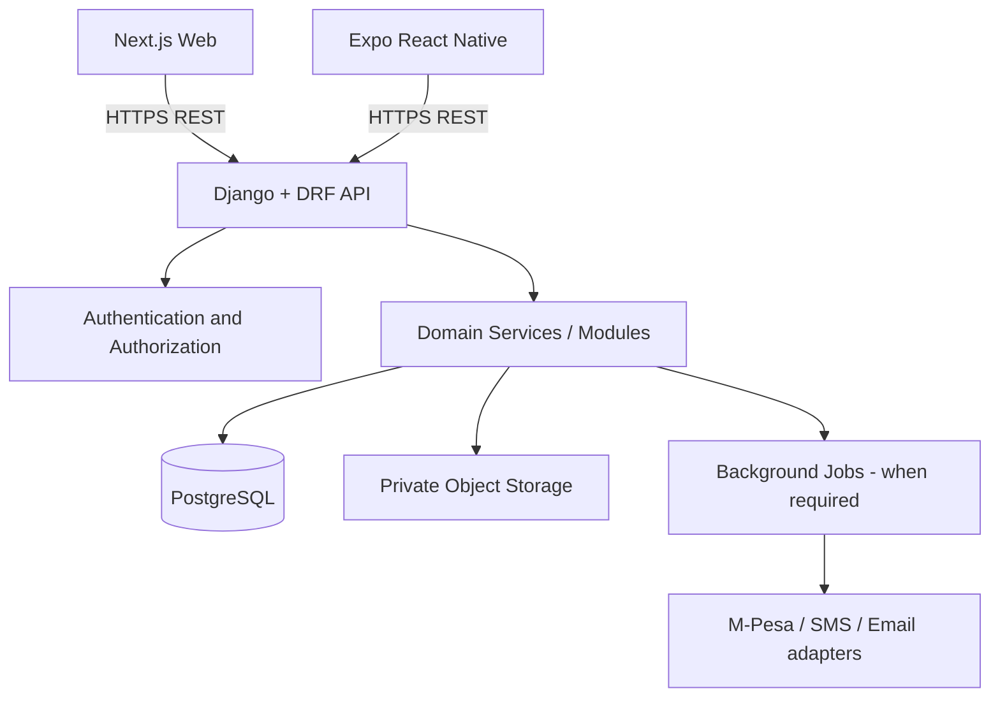

# Architecture

## Baseline

- **Backend:** Django 5.2 LTS + Django REST Framework (DRF)
- **Web:** Next.js (App Router) + TypeScript + Tailwind CSS
- **Mobile:** Expo + React Native + TypeScript
- **Database:** PostgreSQL
- **API Contract:** OpenAPI 3.x generated via `drf-spectacular`
- **Deployment:** Docker-compatible, managed PostgreSQL preferred
- **Architecture Style:** Modular monolith

## Context Diagram



## Backend Modules

- `accounts`: custom user, authentication, token lifecycle, and profile
- `organizations`: organizations, memberships, roles, and settings
- `properties`: property, building, unit (`unit_code`), and ownership
- `leasing`: tenants, occupants, leases, lease events, and deposit ledger
- `billing`: charge rules, invoices, invoice items, and credit/debit adjustments
- `payments`: payment records, suspense/unmatched queue, allocations, reversals, and provider transactions
- `expenses`: expense records and categories
- `maintenance`: requests, assignments, and status history
- `documents`: metadata and private object-storage references
- `notifications`: in-app/email/SMS notification records
- `reporting`: tenant-scoped report queries
- `audit`: append-oriented audit events

## Multi-Tenancy Strategy (MVP)

- Shared PostgreSQL tables with `organization_id` on every organization-owned record.
- All queries and writes are scoped via authenticated `OrganizationMembership` resolved from `X-Organization-ID` (never trusting a client-supplied organization ID without membership verification).
- Cross-tenant negative tests are mandatory for every module.

## API Principles

- REST resources and predictable HTTP semantics
- OpenAPI schema generated from DRF (`drf-spectacular`)
- Pagination and filtering on collections
- Consistent validation and error response format
- Idempotency for payment operations and provider callbacks
- Business rules in backend services, not client code
- Explicit compatibility strategy for mobile app versions

## Repository Layout

```text
pms/
  AGENTS.md
  README.md
  .env.example
  backend/
  web/
  mobile/
  docs/
    decisions/
    agent-prompts/
  infra/
  .github/
```
