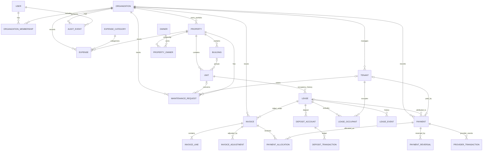

# Initial Database ERD (Approved MVP Baseline)

**Status:** Approved baseline domain model incorporating Kenyan payment reconciliation, deposit ledger, and invoice adjustment requirements.

## ER Diagram

## Key Modeling Rules

1. **Explicit Tenant Scoping:** Every organization-owned table includes `organization_id` (UUID FK to `ORGANIZATION`), even when derivable through a parent. Same-organization foreign key integrity is enforced in services and model validation.
2. **Global User, Scoped Membership:** `USER` is a global identity; `ORGANIZATION_MEMBERSHIP` links a user to an organization with an explicit `role` (`OWNER`, `MANAGER`, `ACCOUNTANT`, `CARETAKER`) and `status`.
3. **Kenyan Payment Reconciliation (`PAYMENT`):**
   - `PAYMENT` includes nullable `lease_id` and `tenant_id` plus `payer_name`, `payer_phone`, and `raw_account_ref` (what the tenant entered as the Paybill Account Number).
   - Unmatched C2B/Bank payments are recorded immediately in a **Suspense / Unmatched** state and can be manually assigned to a lease/tenant by an authorized user without losing funds.
4. **Immutable Ledgers:**
   - `LEASE` terms are never overwritten silently; changes create `LEASE_EVENT` records.
   - `INVOICE` totals are preserved upon issuance; post-issue corrections use `INVOICE_ADJUSTMENT` (Credit/Debit notes).
   - `PAYMENT_REVERSAL` preserves the original `PAYMENT` record and records actor + reason.
   - `DEPOSIT_ACCOUNT` tracks history via append-only `DEPOSIT_TRANSACTION` entries (`RECEIVED`, `DEDUCTED`, `REFUNDED`).
5. **Sequential Numbering:** Per-organization invoice and receipt sequences use row-level locking (`SELECT ... FOR UPDATE`) on a dedicated sequence counter to prevent race conditions during bulk monthly billing.
6. **Decimal Arithmetic:** All monetary fields use `Decimal` (`NUMERIC(14, 2)`), never floating-point types.
7. **URL-Only Media Storage (`ATTACHMENT` — Phase 2):**
   - Binary files (maintenance photos, inspection photos, expense receipts, signed lease PDFs) are stored in external object storage (Cloudflare R2 / S3 / Cloudinary) and referenced in PostgreSQL strictly by `file_url`, `storage_key`, `content_type`, `file_size_bytes`, `entity_type`, and `entity_id`.
8. **Composite Indexing & Concurrency Matrix (Phase 2):**
   - `INVOICE`: composite indexes on `(organization, status, due_date)` and `(organization, billing_period)`.
   - `PAYMENT`: composite indexes on `(organization, status, received_at)` and `(organization, lease, status)`.
   - `EXPENSE`: composite index on `(organization, status, expense_date)`.
   - `MAINTENANCE_REQUEST`: composite index on `(organization, status, priority)`.
   - Concurrency locks (`SELECT ... FOR UPDATE` + `IntegrityError` handling) on `Organization` unit-cap checks, `generate_monthly` invoice batching, and `mpesa_callback` deduplication.
